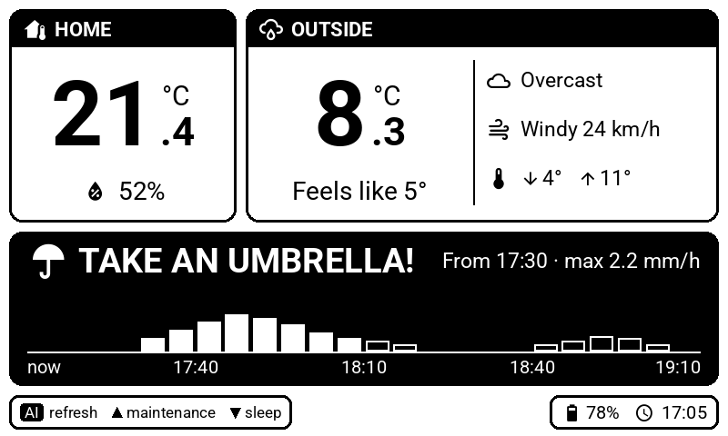
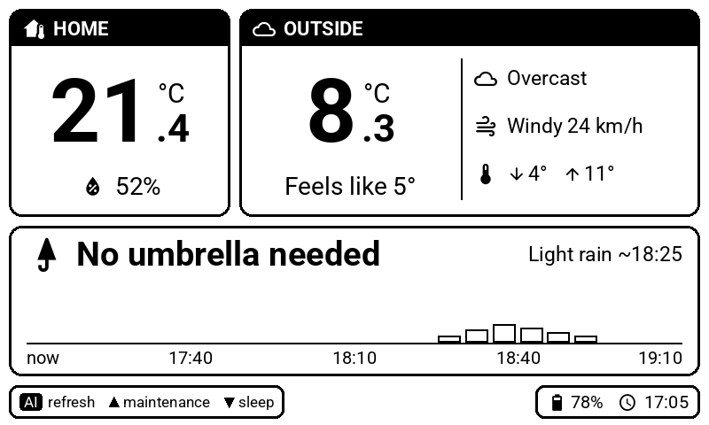

# reTerminal Sticky weather panel (ESPHome)

A battery-friendly home weather panel for the [Seeed Studio reTerminal Sticky](https://www.seeedstudio.com/sticky/) e-paper display, built with [ESPHome](https://esphome.io).

At a glance it tells you:

- 🏠 **Indoor** temperature and humidity (the Sticky's built-in SHT40 sensor)
- 🌳 **Outdoor** temperature, feels-like, sky, wind and today's min/max ([Open-Meteo](https://open-meteo.com))
- ☂️ **Whether to take an umbrella** in the next hour, with a 2-hour rain chart ([Buienradar](https://www.buienradar.nl) radar nowcast, 5-minute resolution)
- 🔋 Battery level and last update time

| Rain in the next hour | Dry |
|---|---|
|  |  |

*Screenshots are simulations rendered with the same fonts and layout as the firmware, using made-up data.*

No Home Assistant, hub or server needed: the Sticky fetches everything itself over Wi-Fi.

## Features

- **Deep sleep between updates.** It wakes up, connects, fetches data, redraws and goes back to sleep. E-paper keeps the image with no power.
- **Configurable schedule:** every 10 min during "peak" windows (by default 12:30–13:30 and 17:30–18:30), every 30 min otherwise, and no updates at night (00:00–06:00 by default).
- **Battery saving:** Wi-Fi is turned off before the screen refresh, the panel power is cut while sleeping, and unused peripherals (touch, mic, microSD, buzzer) stay off. Below 20 % battery it updates at most every 30 min. Below 15 % it shows a "Battery low" warning.
- **Skips redrawing** when nothing on screen has changed (forced redraw at least hourly).
- **Rain fallback:** if Buienradar doesn't answer, it uses Open-Meteo's 15-minute precipitation from the same request.
- **Trend arrows** next to the temperatures (rising or falling over the last hour), kept across deep sleep in RTC memory.
- Only **2 HTTP requests per wake-up**. The clock is set from the HTTP `Date` header if NTP isn't available.

## Buttons

| Button | Action |
|---|---|
| **AI** | Wake up and refresh now |
| **Hold ▲ + press AI** | Wake up in **maintenance mode** (stays awake with Wi-Fi on, for OTA updates) |
| **▼** | Leave maintenance mode and go to sleep |

## Setup

1. Install ESPHome **2026.7.0 or newer** (`brew install esphome` or `pip install esphome`).
2. Copy `secrets.example.yaml` to `secrets.yaml` and fill in your Wi-Fi, an OTA password, your location (`latitude`, `longitude`) and `timezone`.
3. Connect the Sticky with a **data** USB-C cable and flash it:
   ```bash
   esphome run sticky-weather.yaml
   ```
   This replaces the stock firmware (Seeedash).
4. Later updates can go over Wi-Fi: wake it in maintenance mode (hold ▲ + press AI), then
   ```bash
   esphome upload sticky-weather.yaml --device <sticky-ip>
   ```

The Sticky's USB-C port is wired to a CH343P USB-UART on `UART0`, so logs are only visible over the cable (`esphome logs sticky-weather.yaml`).

## Configuration

Everything adjustable is in the `substitutions:` block at the top of `sticky-weather.yaml`:

| Setting | Default | Meaning |
|---|---|---|
| `rain_threshold_mmh` | `0.2` | Rain (mm/h) from which it tells you to take an umbrella |
| `interval_min` | `30` | Update interval outside peak windows (minutes) |
| `peak_interval_min` | `10` | Update interval inside peak windows |
| `peak1`, `peak2` | `12:30–13:30`, `17:30–18:30` | Peak windows, as minutes since midnight |
| `night_start_hour` / `night_end_hour` | `0` / `6` | No updates between these hours |
| `battery_saver_pct` / `battery_warning_pct` | `20` / `15` | Battery % for saving mode / on-screen warning |

The indoor sensor sits inside the case, so it can read a bit high, especially while charging. Uncomment the `offset` filter under `sht4x` to calibrate it against another thermometer.


## Caveats

- **Buienradar** only covers the Netherlands and Belgium, and the `gpsgadget.buienradar.nl/data/raintext` endpoint is not officially documented. Outside NL/BE, the Open-Meteo fallback is used automatically.
- The power-hold, panel-enable and deep-sleep pin handling follows Seeed's Arduino/ESP-IDF examples for the Sticky. It has been tested on one unit only.
- Battery life hasn't been measured precisely yet.

## Credits

- Weather data by [Open-Meteo.com](https://open-meteo.com/) (CC BY 4.0)
- Rain nowcast by [Buienradar.nl](https://www.buienradar.nl)
- Icons: [Material Design Icons](https://pictogrammers.com/library/mdi/) (Apache 2.0), downloaded at build time
- Font: [Roboto](https://fonts.google.com/specimen/Roboto) (OFL), via Google Fonts

## License

[MIT](LICENSE)
